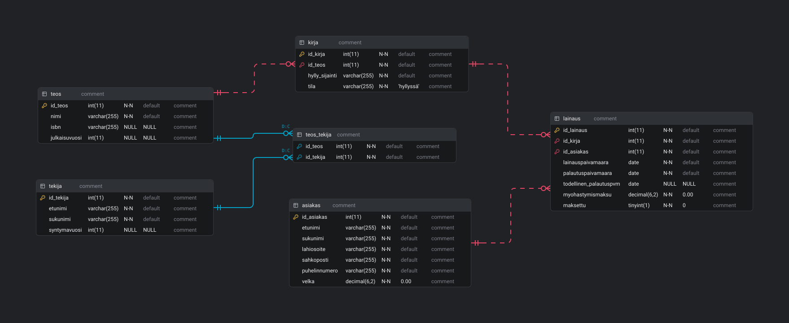

# Kirjastotietokanta

## Esipuhe
Tein tosiaan ihan "oikean" tietokannan ja dumppasin sen [tiedostoksi](./util/kirjasto.sql), josta sain tehtyä tämän siistin ER-diagrammin, ERD Editor nimisellä vscoden lisäosalla. Suunnittelin tietokannan melkolailla kirjoittaessa luontilauseita, jotka löytyy [täältä](kirjastoluonti.sql)

## ER-diagrammi

### 1. tekija
Tästä ei kyllä juurikaan ole sanottavaa, ihan perus erottelevaa tietoa. Tauluun tallennetaan kirjailijat ja muut "kirjailijat".
### 2. teos
Yksilöidään uniikilla ISBN:llä teokset toisistaan, kun kirjoilla voinee kuitenkin olla sama nimi.
Toki ISBN on 13 merkkiä pitkä, mutta sekin tulee nousemaan jossain vaiheessa, joten ei jaksa rajoittaa varcharia pienemmäksi, jos ja kun se nousee tietokanta tulisi päivittää yhden lisä merkin takia, joten teknisesti ottaen tämä pitäisi olla tulevaisuutta kestävä kun tekoäly "kirjoittaa" miljardi roskakirjaa sekunnissa ja kaikille on oltava oma ISBN.
### 3. teos_tekija
Tämä on vain liitostaulu, koska kirjoilla voi olla monta kirjoittajaa ja kirjoittajalla voi olla monta kirjaa, elikkä monesta moneen suhde.
### 4. kirja
Voi olla monta samaa kirjaa, mutta niitä voi olla myös olematta koko kirjastossa jos se on vaikka lainassa tai niin tuore julkaisu ettei sitä vielä ole saatu kirjastoon.
### 5. asiakas
Asiakkaan tiedot että tiedetään sakottaa oikeaa henkilöä, jos ja kun he eivät muista palauttaa lainattuja kirjoja.
Asiakas voi olla olemassa, vaikka hän ei olisikaan kirjaa lainannut.
### 6. lainaus
Tässä taulussa on lainaustapahtumat ja totuusarvo (itselle tutummin "booleani") siitä onko sakot maksettu.

## Pohdintoja
### 1. Ovatko yhteydet taulujen välillä tyyppiä identifying vai non-identifying ?
Suurin osa on non-identifying, paitsi teos_tekija taulusta teos ja tekijä tauluihin, joissa primaryt koostuvat teos_tekija taulun avaimista.

### 2. Ovatko taulujen väliset yhteydet tyyppiä yhdestä yhteen, yhdestä moneen vai monesta moneen ?
Yhdellä kirjoittajalla voi olla monta teosta ja teoksella voi olla monta kirjoittajaa. Tämän takia tein teos_tekija taulun.

### 3. Mitä lisämääreitä kentille kannattaa antaa ? Mikä kenttä voi olla NULL ? Onko joku kenttä UNIQUE ?
Kaikki id tiedot ainakin pitäisi olla uniikkeja jo syntyessään, koska PRIMARY KEY ja AUTO_INCREMENT. 

#### a) NOT NULL 
Pitää olla ainakin nimissä, osoitteissa, yhteystiedoissa, päivämäärissä ja kirjan tilassa.

Laitoin nyt kirja taulussa olevan hylly_sijainti tiedon NOT NULL, mutta se voisi aivan yhtä hyvin olla NULL. 

Tähän vääliin tälläinen lyhyt tarina: Teen töitä eräässä ruokakaupassa jossa käytetään nimenomaan hyllypaikkoja. Niiden perusteella voi suunnistaa oikeaan osoitteeseen, no se on kiva että kyseisessä järjestelmässä hyllypaikkatieto on nimenomaan NOT NULL ja se aiheuttaa sen että uutta tuotetta lisätessä, tietenkään sitä ei tiedetä missä se tuote tulee olemaan, joten järjestelmä "arvaa" oikean paikan, joka on joka ikinen kerta jossain aivan käsittämättömässä paikassa, loppujen lopuksi hyllypaikkojen korjaaminen tahtoo aiheuttaa niin paljon lisätyötä että ihan hirvittää. Kyseisessä järjestelmässä on muutakin sellaista, jota jonkun pitäisi oikeasti ylläpitää paremmin. 

#### b) NULL 
Tekijän syntymävuosi ja julkaisuvuosi voivat olla hukassa tai jos kirjailija on vaikka monen henkilön salanimi, jolloin syntymävuosi on turha tieto. isbn voi olla vielä saamatta, joten sekin voi olla toisaalta tyhjä. todellinen palautuspvm pitää olla null, eihän sitä voi tietää jos vaikka talo palaa ja kirja sen mukana, jolloin kirjaa ei edes voi palauttaa, joten jos se palautettaisiin tietokannan tiedot olisivat virheellisiä ja sielä olisi fyysisesti puuttuvia kirjoja.

#### c) UNIQUE
Minusta minkään muun ei tarvi olla erikseen UNIQUE kuin sähköpostin, puhelinnumeron ja isbn numeron, joka ei voi olla sama millään muulla kirjalla, muuten voi mennä kirjat sekaisin.